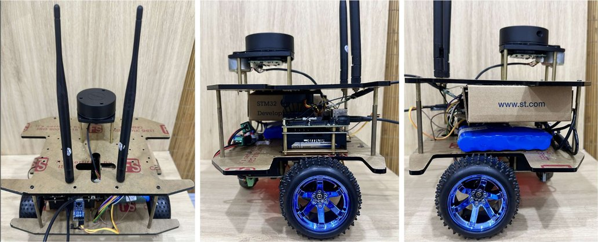
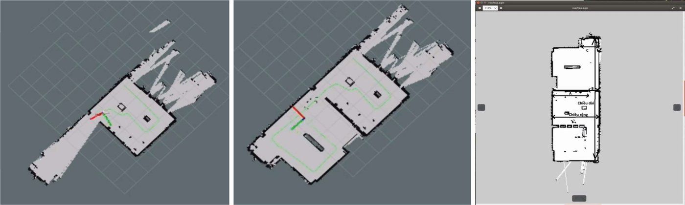
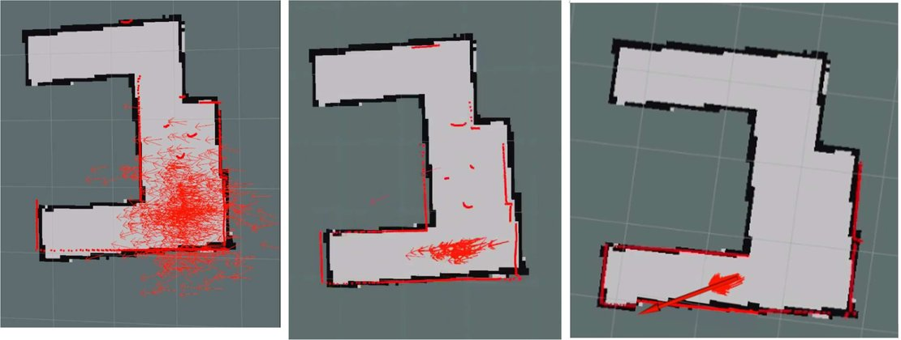
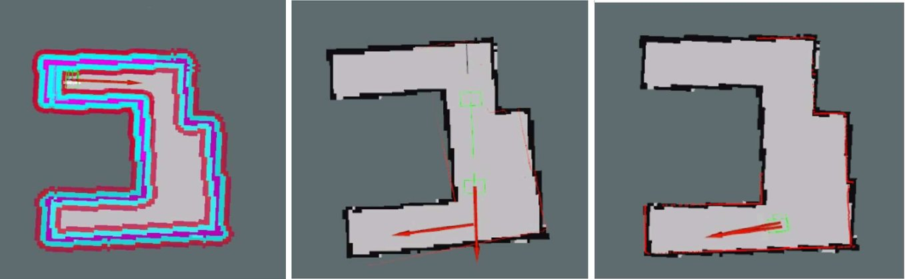

# Autonomous Indoor Mobile Robot using LiDAR

> **Tóm tắt (VI):** Luận văn tốt nghiệp kỹ sư Điều khiển & Tự động hóa, ĐH Bách Khoa TP.HCM (2024). Xe tự hành trong nhà dùng LiDAR: tự dựng bản đồ 2D, tự định vị, hoạch định quỹ đạo và di chuyển tránh vật cản đến điểm đích. STM32F411 điều khiển PID 2 động cơ, giao tiếp UART với Jetson Nano chạy ROS Melodic.

A differential-drive robot that **builds a 2D map** of a room with a LiDAR, **localizes itself** in that map and **plans a path to a goal while avoiding obstacles**. Built from scratch as my engineering thesis (Control & Automation, Ho Chi Minh City University of Technology, 2024): hardware, motor-control firmware and the ROS navigation stack.

<p align="center">
  
</p>


## Highlights

- **Embedded motor control (C, STM32F411)** — encoder reading in x4 mode (TIM2/TIM3), discrete PID speed control for both wheels in a 10 ms timer interrupt, PWM to two BTS7960 H-bridges, UART with DMA to the Jetson, calibration factors stored in on-chip flash.
- **Custom serial protocol** between the MCU and ROS (framed binary floats, see below).
- **SLAM** with `hector_mapping`: maps measured against the real rooms with **1.2 – 2.1 cm average error**.
- **Localization** with wheel odometry + laser scan matching fused by an EKF (`robot_localization`), then `amcl` (particle filter) on the saved map: **2 – 7 cm / 1 – 5° error**.
- **Navigation** with `move_base`: global planner (A*) + DWA local planner, avoids static and moving obstacles.
- **Mechanical design** in SolidWorks; robot assembled and tested in three real rooms.

## System architecture

```
                         Wi-Fi (phone hotspot)
   PC (NoMachine, RViz)  ◄──────────────────►  Jetson Nano B1 — Ubuntu 18.04, ROS Melodic
                                                 ├─ rplidar_ros        ◄── RPLiDAR A1 (USB/UART, 10 Hz, 12 m)
                                                 ├─ hector_mapping / map_server      (mapping)
                                                 ├─ laser_scan_matcher + robot_localization EKF + amcl  (localization)
                                                 ├─ move_base: global_planner (A*) + DWA  (navigation)
                                                 └─ serial bridge node
                                                          ▲  wheel speeds (m/s)
                                                    UART  │
                                                          ▼  wheel speed setpoints (m/s)
                                               STM32F411 Discovery (C, STM32CubeMX + Keil)
                                                 ├─ TIM2 / TIM3: quadrature encoders (x4)
                                                 ├─ TIM5: 10 ms control interrupt → PID
                                                 ├─ TIM4: PWM ──► 2 × BTS7960 ──► 2 × JGB37-545 DC motors
                                                 └─ Flash: stored calibration factors
```

### MCU ↔ ROS serial protocol

Every 10 ms the STM32 sends the measured wheel speeds; ROS answers with the speed setpoints computed from the DWA planner's linear/angular velocity. Both frames have the same layout:

| Byte(s) | 1 | 1 | 4 | 4 | 1 | 1 |
|---|---|---|---|---|---|---|
| **STM32 → ROS** | `$` | `$` | `vel_left` (float) | `vel_right` (float) | `\n` | `\r` |
| **ROS → STM32** | `$` | `$` | `vel_left_setpoint` (float) | `vel_right_setpoint` (float) | `\n` | `\r` |

The two `$` bytes mark the start of a frame; any frame that does not start with them is discarded.

## Hardware

| Component | Part | Role |
|---|---|---|
| Embedded computer | NVIDIA Jetson Nano B1 (4 GB) | Runs ROS: mapping, localization, navigation |
| Microcontroller | STM32F411 Discovery | Encoders, PID, PWM, UART |
| LiDAR | Slamtec RPLiDAR A1 | 360°, 12 m range, 10 Hz, 8000 samples/s |
| Motors | 2 × JGB37-545 DC geared motors with encoders, 85 mm wheels | Differential drive |
| Motor drivers | 2 × BTS7960 (43 A H-bridge) | |
| Power | 12 V 4.8 Ah Li-ion battery | |
| Chassis | 2-deck frame designed in SolidWorks | |

<p align="center">
  
</p>

## Results

### PID speed control

Step response of the right wheel under a ~5 kg load (setpoint 0.1 → 0.7 m/s in 0.1 m/s steps). The controller tracks the setpoint with near-zero steady-state error and only short overshoot at each step; at 0.7 m/s the motor reaches its limit under this load.

<p align="center">
  
</p>

### Mapping (hector_mapping)

The robot is driven around with `teleop_twist_keyboard` while `hector_mapping` builds the map, then `map_saver` stores it (0.05 m/pixel). Distances on the map were compared with tape-measured distances in three rooms:

| Room | Segments measured | Average error |
|---|:---:|:---:|
| Attic room | 5 | **1.5 cm** |
| Bedroom 1 | 7 | **1.2 cm** |
| Bedroom 2 | 7 | **2.12 cm** |

<p align="center">
  
</p>

### Localization (AMCL)

Particles start spread around the initial pose and converge after the robot moves 1 – 2 m. Measured at 5 positions in Bedroom 2: **X/Y error 2 – 7 cm, heading error 1 – 5°**.

<p align="center">
  
</p>

### Path planning and obstacle avoidance (move_base)

Given a goal in RViz, the robot plans a global path (A*) on the inflated costmap and follows it with the DWA local planner. Final pose error over 5 goals: **4 – 10 cm in X/Y, 6 – 10° in heading**.

<p align="center">
  
</p>

### Limitations and next steps

- Localization becomes unstable when the robot moves or turns fast, and in very symmetric rooms with few features.
- Goal accuracy (up to 10 cm) and the time spent orienting at the goal call for more DWA / AMCL tuning.
- Next: fuse an IMU (and camera) to improve localization, and turn the platform into an indoor cleaning robot.

## Repository structure

```
├── firmware/stm32f411_motor_controller/   # STM32 firmware (STM32CubeMX project + Keil MDK)
│   ├── Core/Src/main.c                    #   timers, encoders, 10 ms control interrupt
│   ├── Core/Inc/PID.h, uart.h, flash.h    #   PID, UART framing and flash interfaces
│   └── L1.ioc                             #   CubeMX configuration (pins, timers, DMA)
├── ros_ws/src/
│   ├── navstack_pub/                      # Navigation package
│   │   ├── launch/navigation.launch       #   full stack: LiDAR + odometry + map + AMCL + move_base
│   │   ├── launch/localization.launch     #   map + AMCL only
│   │   ├── launch/mapping_gmapping.launch #   alternative mapping with gmapping
│   │   ├── param/                         #   costmap, DWA and global planner parameters
│   │   └── maps/                          #   maps of the test rooms (.pgm + .yaml)
│   └── temp_pkg/                          # Robot bring-up: LiDAR + serial bridge, wheel odometry
└── docs/images/                           # Figures from the thesis
```

> **Note on the firmware:** this is a development snapshot of the STM32 project. The PID, UART and flash helpers are declared in `Core/Inc/*.h`; their `.c` implementations and the STM32 HAL `Drivers/` folder are not included. Regenerate the HAL drivers with STM32CubeMX from `L1.ioc`.

## Running the ROS stack

Tested on Jetson Nano B1, Ubuntu 18.04, ROS Melodic.

```bash
sudo apt install ros-melodic-navigation ros-melodic-robot-localization \
                 ros-melodic-hector-slam ros-melodic-rplidar-ros \
                 ros-melodic-scan-tools ros-melodic-map-server ros-melodic-teleop-twist-keyboard

cd ros_ws && catkin_make && source devel/setup.bash

# Full navigation on a saved map (set the goal with "2D Nav Goal" in RViz)
roslaunch navstack_pub navigation.launch
```

The serial bridge node (`serial_example` package, built on the `serial` library) that talks to the STM32 is required by `temp_pkg/launch/serial.launch`.

## Credits

The wheel-odometry node (`temp_pkg/src/temp.cpp`) and the goal-sending node (`navstack_pub/src/send_goals.cpp`) are adapted from [Automatic Addison](https://automaticaddison.com) tutorials, as noted in their headers. Mapping, localization and planning use the open-source ROS packages listed above.

Thesis supervisor: Dr. Phạm Việt Cường — Department of Automatic Control, Ho Chi Minh City University of Technology (HCMUT).
