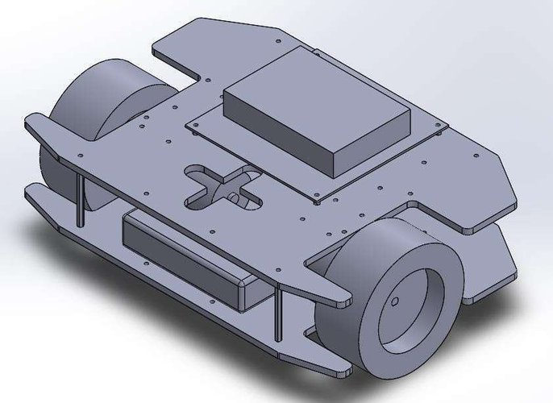
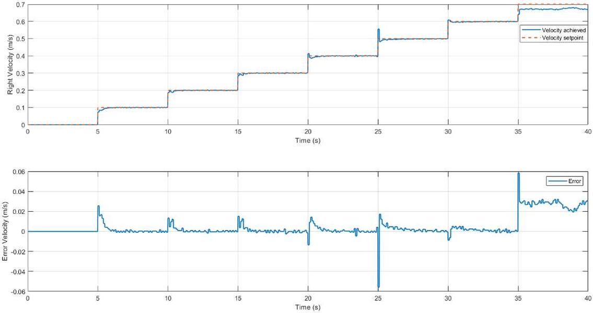
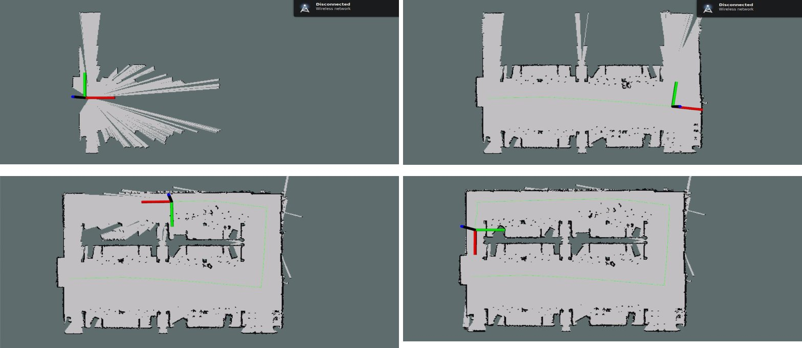
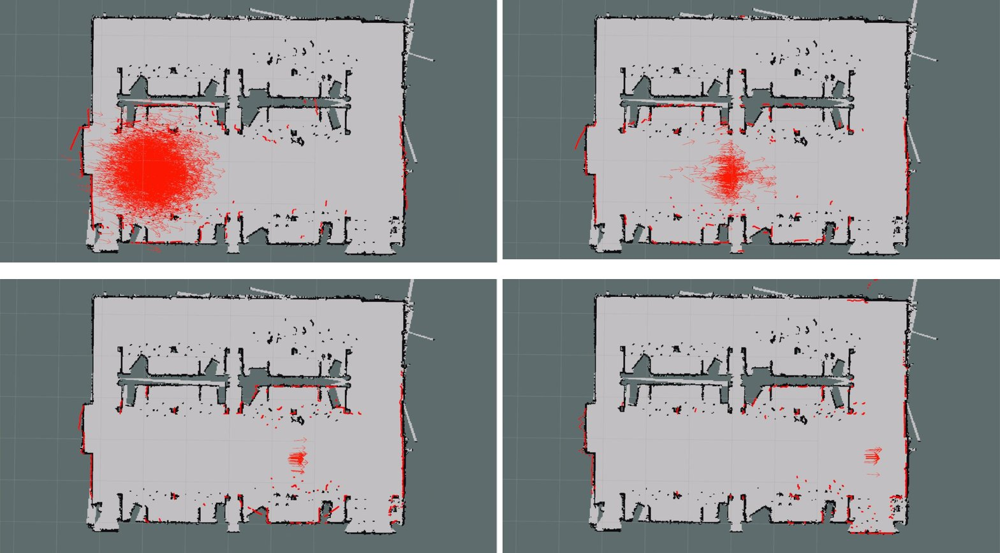
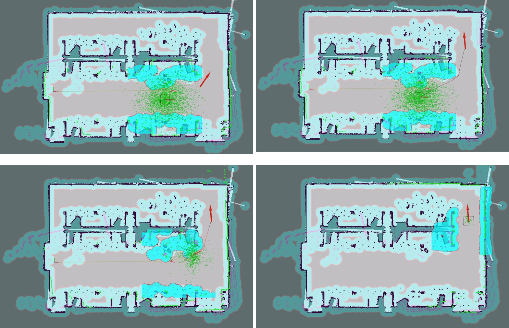

# Autonomous Indoor Mobile Robot using LiDAR

> **Tóm tắt (VI):** Luận văn tốt nghiệp kỹ sư Điều khiển & Tự động hóa, ĐH Bách Khoa TP.HCM (2024). Xe tự hành trong nhà dùng LiDAR: tự dựng bản đồ 2D, tự định vị, hoạch định quỹ đạo và di chuyển tránh vật cản đến điểm đích. STM32F411 điều khiển PID 2 động cơ, giao tiếp UART với Jetson Nano chạy ROS Melodic.

A differential-drive robot that **builds a 2D map** of a room with a LiDAR, **localizes itself** in that map and **plans a path to a goal while avoiding obstacles**. Built from scratch as my engineering thesis (Control & Automation, Ho Chi Minh City University of Technology, 2024): hardware, motor-control firmware and the ROS navigation stack.

<p align="center">
  
</p>


## Highlights

- **Embedded motor control (C, STM32F411)** — quadrature encoders on TIM2/TIM3, discrete PID speed control of both wheels in a 10 ms timer interrupt, 10 kHz PWM to two BTS7960 H-bridges, UART with DMA reception to the Jetson.
- **Custom serial protocol** between the MCU and ROS (framed binary floats, see below).
- **SLAM** with `hector_mapping`: maps measured against the real rooms with **1.3 – 1.4 cm average error**.
- **Localization** with wheel odometry + laser scan matching fused by an EKF (`robot_localization`), then `amcl` (particle filter) on the saved map: **1 – 7 cm / 1 – 5° error**.
- **Navigation** with `move_base`: global planner (A*) + DWA local planner, avoids static and moving obstacles, reaches goals within **6 cm / 4°**.
- **Mechanical design** in SolidWorks; robot assembled and tested in real rooms.

## System architecture

```
                         Wi-Fi (phone hotspot)
   PC (NoMachine, RViz)  ◄──────────────────►  Jetson Nano B1 — Ubuntu 18.04, ROS Melodic
                                                 ├─ rplidar_ros        ◄── RPLiDAR A1 (USB/UART, 10 Hz, 12 m)
                                                 ├─ hector_mapping / map_server      (mapping)
                                                 ├─ laser_scan_matcher + robot_localization EKF + amcl  (localization)
                                                 ├─ move_base: global_planner (A*) + DWA  (navigation)
                                                 └─ serial bridge node
                                                          ▲  measured wheel speeds
                                              UART 115200 │
                                                          ▼  wheel speed setpoints
                                               STM32F411 Discovery (C, STM32CubeMX + Keil)
                                                 ├─ TIM2 / TIM3: quadrature encoders
                                                 ├─ TIM5: 10 ms control interrupt → PID
                                                 ├─ TIM4: 10 kHz PWM ──► 2 × BTS7960 ──► 2 × JGB37-545 DC motors
                                                 └─ USART6 (RX via DMA) ◄──► Jetson
```

### MCU ↔ ROS serial protocol

Binary frames over UART (115200 baud), wheel speeds as 4-byte little-endian `float`s (rpm):

| Direction | Header | Data | Tail | Size | Rate |
|---|---|---|---|:---:|:---:|
| **STM32 → ROS** (measured speeds) | `0x24 0x24` (`$$`) | `left` float, `right` float | `0x0D 0x0A` | 12 B | every 60 ms |
| **ROS → STM32** (setpoints) | `0x55 0xAA` | `left_set` float, `right_set` float | — | 10 B | received by DMA |

The bridge node on the Jetson turns the DWA planner's linear/angular velocity (`/cmd_vel`) into left/right wheel setpoints. Frames whose header does not match are ignored, so a corrupted or shifted frame never drives the motors.

### Firmware: PID speed control

Every 10 ms (TIM5 interrupt) the STM32 reads and resets each encoder counter, converts the count to rpm, and runs an incremental (velocity-form) discrete PID with trapezoidal integration:

```c
e[k] = setpoint - speed;
u[k] = u[k-1] + Kp*(e[k] - e[k-1]) + (Ki*T/2)*(e[k] + e[k-1]) + (Kd/T)*(e[k] - 2*e[k-1] + e[k-2]);
// Kp = 5, Ki = 350, Kd = 0.01, T = 0.01 s; u clamped to ±999 (PWM duty), sign selects direction
```

Source: [`firmware/stm32f411_motor_controller/Core/Src/main.c`](firmware/stm32f411_motor_controller/Core/Src/main.c) (`HAL_TIM_PeriodElapsedCallback`).

## Hardware

| Component | Part | Role |
|---|---|---|
| Embedded computer | NVIDIA Jetson Nano B1 (4 GB) | Runs ROS: mapping, localization, navigation |
| Microcontroller | STM32F411 Discovery (100 MHz Cortex-M4) | Encoders, PID, PWM, UART |
| LiDAR | Slamtec RPLiDAR A1 | 360°, 12 m range, 10 Hz, 8000 samples/s |
| Motors | 2 × JGB37-545 DC geared motors with encoders, 85 mm wheels | Differential drive |
| Motor drivers | 2 × BTS7960 (43 A H-bridge) | |
| Power | 12 V 4.8 Ah Li-ion battery | |
| Chassis | 2-deck frame designed in SolidWorks | |

<p align="center">
  
</p>

## Results

### PID speed control

Step response of the right wheel under a ~5 kg load (setpoint 0.1 → 0.7 m/s in 0.1 m/s steps). The controller tracks the setpoint with near-zero steady-state error and only short overshoot at each step; at 0.7 m/s the motor reaches its limit under this load.

<p align="center">
  
</p>

> The mapping, localization and navigation experiments below were run in 2022 on the earlier **LiDAR + IMU version** of the robot, in rooms 207B3 and 205B3.

### Mapping (hector_mapping)

The robot is driven around with `teleop_twist_keyboard` while `hector_mapping` builds the map, then `map_saver` stores it (0.05 m/pixel). Distances on the map were compared with tape-measured distances:

| Room | Segments measured | Average error | Max error |
|---|:---:|:---:|:---:|
| 207B3 (5.5 × 7.2 m) | 6 | **1.3 cm** | 2.0 cm |
| 205B3 (7.1 × 9.8 m) | 7 | **1.4 cm** | 3.7 cm |

<p align="center">
  
</p>

### Localization (AMCL)

Particles start spread around the initial pose and converge after the robot moves 3 – 5 m. Measured at 10 positions in room 207B3: **X/Y error 1 – 7 cm, heading error 1 – 5°**. Accuracy drops very close to walls, far from features, and near steel objects that disturb the IMU.

<p align="center">
  
</p>

### Path planning and obstacle avoidance (move_base)

Given a goal in RViz, the robot plans a global path (A*) on the inflated costmap and follows it with the DWA local planner while AMCL keeps localizing. Final pose error over 10 goals in rooms 207B3 and 205B3: **0 – 6 cm in X/Y, 1 – 4° in heading**.

<p align="center">
  
</p>

### Limitations and next steps

- Localization becomes unstable when the robot moves or turns fast, and in very symmetric rooms with few features.
- Localization needs a feature-rich environment; steel objects disturb the IMU, so it must be recalibrated regularly.
- Next: add a camera to improve localization, and turn the platform into an indoor cleaning robot.

## Repository structure

```
├── firmware/stm32f411_motor_controller/   # STM32 firmware (STM32CubeMX + Keil MDK-ARM)
│   ├── Core/Src/main.c                    #   encoders, PID, PWM and UART protocol (10 ms interrupt)
│   ├── TestEnc.ioc                        #   CubeMX configuration (pins, timers, DMA, clocks)
│   └── MDK-ARM/TestEnc.uvprojx            #   Keil project
├── ros_ws/src/
│   ├── navstack_pub/                      # Navigation package
│   │   ├── launch/navigation.launch       #   full stack: LiDAR + odometry + map + AMCL + move_base
│   │   ├── launch/localization.launch     #   map + AMCL only
│   │   ├── launch/mapping_gmapping.launch #   alternative mapping with gmapping
│   │   ├── param/                         #   costmap, DWA and global planner parameters
│   │   └── maps/                          #   maps of the test rooms (.pgm + .yaml)
│   └── temp_pkg/                          # Robot bring-up: LiDAR + serial bridge, wheel odometry
└── docs/images/                           # Figures from the thesis
```

> **Building the firmware:** the STM32 HAL/CMSIS `Drivers/` folder is not committed. Open `TestEnc.ioc` in STM32CubeMX and click *Generate Code* to restore it, then build and flash `MDK-ARM/TestEnc.uvprojx` with Keil µVision.

## Running the ROS stack

Tested on Jetson Nano B1, Ubuntu 18.04, ROS Melodic.

```bash
sudo apt install ros-melodic-navigation ros-melodic-robot-localization \
                 ros-melodic-hector-slam ros-melodic-rplidar-ros \
                 ros-melodic-scan-tools ros-melodic-map-server ros-melodic-teleop-twist-keyboard

cd ros_ws && catkin_make && source devel/setup.bash

# Full navigation on a saved map (set the goal with "2D Nav Goal" in RViz)
roslaunch navstack_pub navigation.launch
```

The serial bridge node (`serial_example` package, built on the `serial` library) that talks to the STM32 is required by `temp_pkg/launch/serial.launch`.

## Credits

The wheel-odometry node (`temp_pkg/src/temp.cpp`) and the goal-sending node (`navstack_pub/src/send_goals.cpp`) are adapted from [Automatic Addison](https://automaticaddison.com) tutorials, as noted in their headers. Mapping, localization and planning use the open-source ROS packages listed above.

Thesis supervisor: Dr. Phạm Việt Cường — Department of Automatic Control, Ho Chi Minh City University of Technology (HCMUT).
